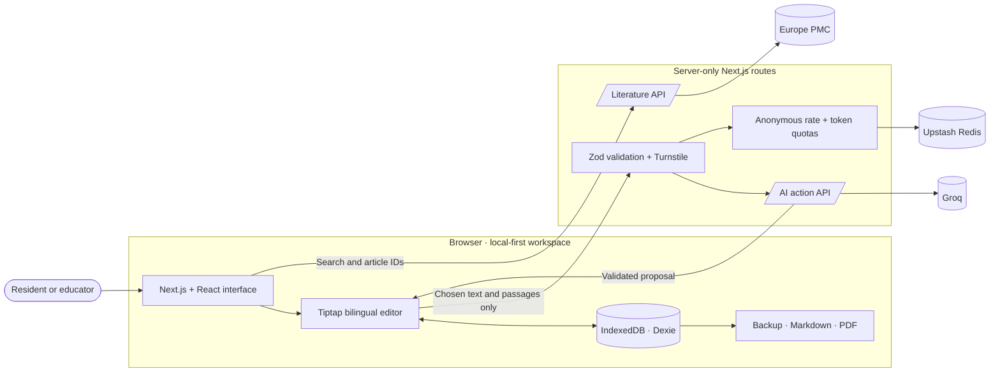

# ImagingQuill

**Read the evidence. Write your understanding.**

ImagingQuill is a local-first radiology learning workspace that brings structured notes, literature discovery, citations, reviewed AI writing support, and revision material into one focused workflow.

     

   


## The workflow

**Create a note → find evidence → save references → insert citations → improve selected text → review the proposal → generate revision material → export or back up.**

ImagingQuill is designed for radiology residents and educators who want one place to turn reading into durable learning. AI actions remain proposals: the user sees the result, checks the wording and evidence, and explicitly accepts or rejects it.

## Features

- English and Arabic rich-text notes with paragraph direction controls, tables, checklists, images, captions, tags, favorites, and autosave.
- A local document library with search, templates, recoverable snapshots, backup, restore, and clear saving status.
- Europe PMC search with publication filters, abstracts, source links, saved references, and licensed source passages.
- Numbered Vancouver-style citations with automatic bibliography generation and duplicate detection.
- AI simplification, shortening, restructuring, English/Arabic translation, source-based explanations, and passage summaries.
- Proposal previews with accept, reject, and copy controls; generated text never silently replaces a note.
- Editable flashcards and revision questions with a lightweight review mode.
- Markdown and image export, print-ready PDF output, and portable document backups.
- Graceful offline and provider-failure behavior: notes remain editable and exportable when external services are unavailable.

## Architecture

ImagingQuill separates private document storage from external research and AI services. Notes stay inside the browser, while server routes expose a small, validated integration boundary.



| Layer | Responsibility |
| --- | --- |
| Public interface | Next.js App Router pages, responsive React UI, Tailwind styling, templates, onboarding, and accessibility states |
| Writing workspace | Tiptap document editing, bilingual direction, citations, bibliography, revision cards, and exports |
| Local persistence | Dexie on IndexedDB for notes and snapshots; versioned archives for portable backup and restore |
| Literature integration | Server-side Europe PMC adapters that normalize search, article, licence, and full-text passage data |
| AI integration | A single server route that accepts an allowed action, selected text, and explicitly chosen source passages |
| Validation and protection | Zod schemas, sanitization, Turnstile verification, anonymous counters, and shared token reservations through Upstash |

### Request lifecycle

1. Notes autosave directly to IndexedDB and never require an account.
2. Literature queries pass through server routes and return normalized Europe PMC records.
3. Citations always use retrieved bibliographic metadata rather than model-generated references.
4. An AI request contains only the selected note text and source passages chosen by the user.
5. The server validates the request, verifies Turnstile, reserves quota, and calls Groq.
6. The browser receives a validated proposal and applies it only after explicit user approval.

## Data and responsible use

Documents stay in the current browser. Clearing browser data or changing devices can remove access to notes, so portable backups should be exported regularly. Selected text and selected source passages leave the device only when the user requests an AI action; the application does not store document content, prompts, or responses in its database or operational logs.

Literature is provided by [Europe PMC](https://europepmc.org/RestfulWebService). Article rights remain with their respective holders. Source-based AI accepts explicitly supported CC BY or CC0 content and preserves links to the original record. Review [Europe PMC reuse terms](https://europepmc.org/Copyright) and the licence attached to each article.

ImagingQuill is for education and fictional exercises. Do not enter patient information or use generated drafts for clinical decisions. AI wording and references require human review. If shared free-provider allowances are temporarily unavailable, editing, backups, and exports continue to work.

## Development

Use Node.js 24 LTS.

```sh
npm ci
cp .env.example .env.local
npm run dev
```

Open the local URL printed by Next.js and set `NEXT_PUBLIC_SITE_URL` to that exact origin. Add your own Groq key, Upstash REST credentials, and Turnstile keys to `.env.local`.

Generate the rate-limit hashing secret with:

```sh
node -e "console.log(require('crypto').randomBytes(32).toString('hex'))"
```

For local development, use Cloudflare's [official Turnstile test keys](https://developers.cloudflare.com/turnstile/troubleshooting/testing/). Production AI rejects test keys. Never commit `.env.local` or share secret values.
