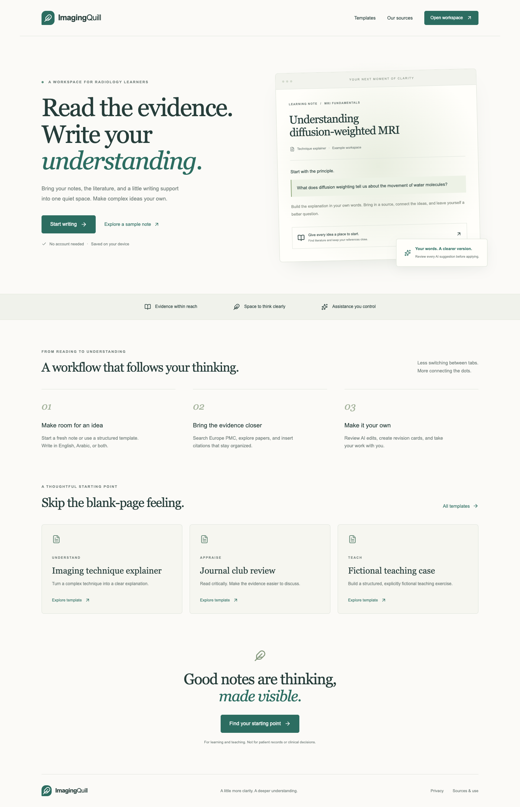

# ImagingQuill

**Read the evidence. Write your understanding.**

A radiology learning workspace for notes, literature, citations, and reviewed AI suggestions. Built with Next.js, TypeScript, Tailwind, Tiptap, and IndexedDB.



## Features

- English and Arabic rich-text notes, tables, captioned images, tags, favorites, local history, and autosave.
- Europe PMC literature search, numbered citations, and an automatic bibliography.
- AI simplification, shortening, restructuring, translation, source-based explanations, and passage summaries.
- Editable flashcards and revision questions, with a simple review mode.
- Markdown/image export, browser PDF printing, and portable backup/restore.

## Run locally

Use Node.js 24 LTS.

```sh
npm ci
cp .env.example .env.local
npm run dev
```

Open the local URL printed by Next.js. Set `NEXT_PUBLIC_SITE_URL` to that exact origin.

Add your own Groq key, Upstash REST credentials, and Turnstile keys to `.env.local`. Generate `RATE_LIMIT_HASH_SECRET` with `node -e "console.log(require('crypto').randomBytes(32).toString('hex'))"`.

For local development, use Cloudflare's [official test keys](https://developers.cloudflare.com/turnstile/troubleshooting/testing/). Production AI rejects those test keys. Never commit `.env.local` or share secret values.

## Deploy on Vercel

Import this repository using the Next.js preset. Use `npm ci` to install and `npm run build` to build. Add the environment variables from `.env.example` to Vercel, set the production site URL, and add the assigned hostname to your Turnstile widget. Replace the test keys with the widget's real site key and secret, then redeploy.

The build uses webpack for compatibility with the local build environment. No special Vercel output-directory setting is needed. Choose a Vercel function region close to your Upstash database.

## Data and use

Documents stay in the current browser. Export backups regularly: clearing browser data can delete your notes. Selected text and selected source passages are sent to Groq only when AI is requested. The app does not store those requests in its database or application logs.

Literature is provided by [Europe PMC](https://europepmc.org/RestfulWebService), independently of this project. Article rights remain with their rights holders. Source-based AI accepts explicitly supported CC BY/CC0 content and keeps source links available. Review [Europe PMC reuse terms](https://europepmc.org/Copyright) and each article's licence.

For education and fictional exercises only. Do not enter patient information or use AI drafts for clinical decisions. Verify AI wording and references before relying on them.

Free provider allowances are shared and limited. When AI is unavailable, editing, backups, and exports remain usable.

Project maintainer: Muhannad Abdallah.
